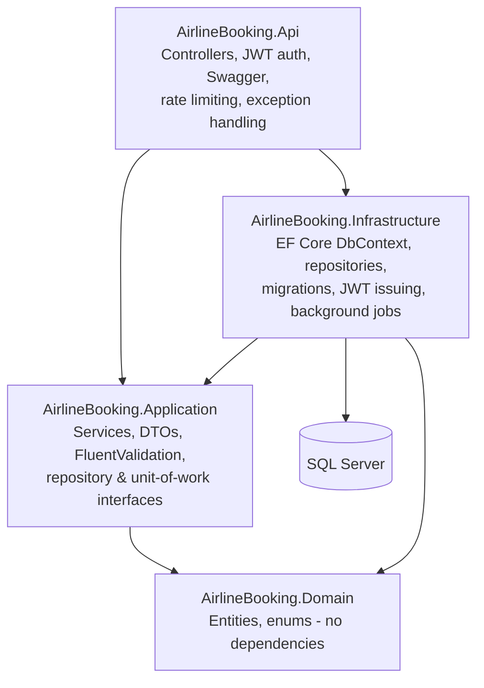

# Airline Booking API

An airline booking & reservation API - a realistic, scoped-down version of the systems an
airline runs internally for its booking agents. Flight search, seat maps, and the
hold → confirm/cancel booking lifecycle, built on ASP.NET Core, EF Core, and SQL Server.

## Why this exists

This is a portfolio project demonstrating a realistic Microsoft-stack backend: C#, ASP.NET
Core, SQL Server, EF Core, REST + OpenAPI, GitHub Actions CI/CD, automated testing, and applied
security practices. Rather than build a generic CRUD demo, this project models a domain
(flights, seats, fares, bookings) with real invariants worth getting right - seat
double-booking, timed holds, load-factor pricing - and doubles as a learning vehicle for .NET
idioms along the way.

## What it does

- **Flight search** by origin, destination, and/or departure date.
- **Seat maps** with live per-flight availability, computed by a SQL Server stored procedure.
- **Fare quoting** - base fare × fare-class multiplier, plus a load-factor surcharge that rises
  as a flight fills up, computed by a second stored procedure.
- **Booking lifecycle**: hold a seat (15-minute expiry) → confirm → or cancel. A held seat is
  provably unavailable to every other caller from the moment it's held, not just once confirmed.
- **Passenger management** (create/update/list).
- **JWT-based staff auth** with two roles - `Agent` (search, book, manage passengers) and
  `Admin` (all of the above, plus flight/aircraft/fare-class management and staff onboarding).

Out of scope for v1 (see [Future work](#future-work)): payment processing, real GDS/airline
system integrations, and a passenger-facing UI - this is an internal agent-facing API, the way
real airline reservation tooling actually works.

## Architecture

Four-layer, dependency-flows-inward architecture: `Api` depends on `Application` and
`Infrastructure`; `Infrastructure` depends on `Application`; `Application` depends only on
`Domain`; `Domain` depends on nothing.



**Controllers → Services → Repositories → EF Core**, per layer:

| Layer | Responsibility |
|---|---|
| `AirlineBooking.Domain` | Entities (`Flight`, `Seat`, `Booking`, ...) and enums. No framework dependencies at all - this is the one thing every other project can safely depend on. |
| `AirlineBooking.Application` | Business logic (`BookingService`, `FlightService`, ...), request/response DTOs, FluentValidation validators, and the *interfaces* for repositories/unit-of-work/auth - Application defines what it needs from persistence without knowing EF Core exists. |
| `AirlineBooking.Infrastructure` | Implements those interfaces: the EF Core `DbContext`, Fluent API entity configurations, migrations, repositories, JWT issuing (`AuthService`), and a `BackgroundService` that sweeps expired booking holds. |
| `AirlineBooking.Api` | Controllers, JWT Bearer validation, Swagger/OpenAPI, global exception handling, rate limiting - the thinnest layer, wiring the others together. |

### Why a repository layer, given EF Core's `DbContext` already *is* a Unit-of-Work/Repository

This is a real trade-off worth being honest about in an interview. `DbSet<T>` plus
`SaveChangesAsync` already gives you most of what the Repository pattern provides, and a lot of
modern .NET codebases skip an extra repository layer entirely and inject `DbContext` straight
into services. I added one anyway, for three reasons specific to this project:

1. The brief this project follows explicitly asks for a `Controllers → Services →
   Repositories/EF Core` layered architecture.
2. It keeps `AirlineBooking.Application` genuinely EF-Core-agnostic - services depend on
   `IBookingRepository`, not `DbContext`, so the Application layer has zero package reference
   to EF Core at all (verified: it doesn't compile if you try to sneak one in).
3. It gives the stored-procedure calls (seat availability, fare quoting) a clean seam -
   `ISeatRepository.GetSeatAvailabilityAsync` reads like any other repository method from the
   caller's side, even though underneath it's `FromSqlInterpolated` against a raw `EXEC`.

The honest counter-argument: for a project this size, the repositories are close to a
pass-through over `DbSet<T>`, and a critic could reasonably call this an unnecessary
abstraction layer. I'd make the same call again here specifically because of point 2 above -
but I'd weigh it differently on a smaller CRUD-only service.

### Why JWT (not cookie) auth

This API has no browser session to piggyback on - it's meant to be called by internal tooling
(and, in this repo, tested via Swagger/curl), not rendered by a server-side view. JWTs are
stateless (no server-side session store to scale or invalidate) and carry the caller's role
claim directly, which is what `[Authorize(Roles = ...)]` reads on every request without a
database round-trip. The trade-off: revoking a single compromised token before it expires isn't
possible without adding a token-blocklist - acceptable here given the short (60-minute) token
lifetime, called out explicitly in [SECURITY.md](SECURITY.md).

### The seat-double-booking guard (the one invariant this domain can't get wrong)

Enforced twice, deliberately:

1. **App-level check** (`IBookingRepository.IsSeatTakenAsync`) gives a clean `409 Conflict` in
   the common case.
2. **A SQL Server filtered unique index** on `Bookings (FlightId, SeatId) WHERE Status IN
   ('Held', 'Confirmed')` (see `BookingConfiguration.cs`) is what actually closes the race: if
   two concurrent hold requests for the same seat both pass check #1 before either commits,
   only one `INSERT` satisfies the index. The loser's `DbUpdateException` is caught in
   `AirlineBookingDbContext.SaveChangesAsync` and translated into the same `ConflictException`
   the app-level check throws, so callers can't tell which path caught it.

### Other decisions worth flagging

- **Hand-rolled JWT auth, not full ASP.NET Core Identity.** Identity brings ~7 tables, external
  login providers, 2FA, email confirmation - none of which this single-login-flow internal API
  needs. It does reuse Identity's `PasswordHasher<T>` for the one part not worth reinventing:
  salted, versioned password hashing.
- **Enums stored as strings in SQL Server** (`HasConversion<string>()`), not the default int.
  Slightly more storage, but self-documenting when browsing tables directly, and immune to a
  future dev silently corrupting data by reordering enum members (an int-backed column would
  just start meaning something else).
- **.NET 10, not .NET 8.** The brief asked for "the latest LTS .NET version." At the time of
  writing, .NET 10 (released November 2025) is the current LTS - .NET 8's LTS window is still
  open but it's no longer *the* current one, and .NET 9 was always a shorter-support release
  train. Went with what's actually current rather than what's most commonly referenced in
  slightly older docs.
- **SQL Server via Docker, not SQL Server LocalDB.** LocalDB is Windows-only and tied to a
  single machine's SQL Server install; a `docker-compose.yml` (see below) works the same way
  on any dev machine or CI runner, and mirrors how the integration test suite gets its own
  disposable SQL Server via Testcontainers.
- **Testcontainers over EF Core's InMemory provider for integration tests.** InMemory doesn't
  enforce the filtered unique index or run real stored procedures - exactly the two things in
  this codebase most worth testing against something real. See
  `tests/AirlineBooking.IntegrationTests/CustomWebApplicationFactory.cs`.

## Tech stack

ASP.NET Core 10 (Web API, controller-based) · EF Core 10 (SQL Server provider, code-first
migrations) · SQL Server 2022 · FluentValidation · JWT Bearer auth ·
`Microsoft.AspNetCore.Identity`'s `PasswordHasher<T>` · Swashbuckle/Swagger · xUnit + Moq
(unit tests) · Testcontainers (integration tests) · GitHub Actions.

## Getting started

### Prerequisites

- [.NET 10 SDK](https://dotnet.microsoft.com/download)
- [Docker](https://www.docker.com/) (for local SQL Server, and for the integration test suite)

### 1. Start SQL Server

```bash
docker compose up -d
```

This starts a SQL Server 2022 container on `localhost:1433`. The `sa` password used here is a
throwaway local-dev-only value defined in `docker-compose.yml` - see [SECURITY.md](SECURITY.md)
for why that's fine to commit but `appsettings.Development.json` isn't.

### 2. Configure local secrets

```bash
cp src/AirlineBooking.Api/appsettings.Development.json.example src/AirlineBooking.Api/appsettings.Development.json
```

The example file's connection string and JWT signing key already match the `docker-compose.yml`
defaults, so no edits are required for local dev.

### 3. Run the API

```bash
dotnet run --project src/AirlineBooking.Api
```

On first run in the `Development` environment, the app automatically applies pending EF Core
migrations and seeds reference data - one `Admin` staff user, one aircraft with a 12-seat map,
one scheduled flight, and three fare classes (see `DbSeeder.cs`). This auto-migrate-on-boot
behavior is intentionally `Development`-only; see the comment in `Program.cs` for why it'd be
unsafe in a real multi-instance production deploy.

Seeded admin credentials: **`admin` / `Admin#Passw0rd1`**.

Swagger UI: `http://localhost:5080/swagger` (also `Development`-only). Click **Authorize** and
paste the `accessToken` from `POST /api/auth/login` to call authenticated endpoints from the UI.

### Running tests

```bash
dotnet test
```

- **Unit tests** (`tests/AirlineBooking.UnitTests`) mock every repository and exercise service
  logic in isolation - the booking hold/confirm/cancel state machine, seat-ownership
  validation, and FluentValidation rules.
- **Integration tests** (`tests/AirlineBooking.IntegrationTests`) spin up a real, disposable
  SQL Server via [Testcontainers](https://testcontainers.com/), run migrations against it, and
  drive the full HTTP pipeline (`WebApplicationFactory<Program>`) - including the stored
  procedures and the filtered unique index a mocked test can't verify. Requires Docker to be
  running; no other setup needed.

## API overview

Full interactive docs live in Swagger once the app is running. Summary:

| Endpoint | Auth | Notes |
|---|---|---|
| `POST /api/auth/login` | Anonymous | Rate-limited to 5/min/IP |
| `POST /api/auth/register` | Admin | Onboards a new staff account |
| `GET /api/flights` | Any staff | Search by origin/destination/date |
| `POST /api/flights` | Admin | Schedule a new flight |
| `GET /api/flights/{id}/seats` | Any staff | Live seat map (stored procedure) |
| `GET /api/flights/{id}/fare-quote` | Any staff | Priced quote (stored procedure) |
| `GET/POST/PUT /api/passengers` | Any staff | |
| `POST /api/bookings` | Any staff | Hold a seat (15-min expiry) |
| `POST /api/bookings/{ref}/confirm` | Any staff | |
| `POST /api/bookings/{ref}/cancel` | Any staff | |
| `GET/POST /api/aircraft`, `GET/POST /api/fare-classes` | Any staff / Admin (POST) | Reference data |
| `GET /health` | Anonymous | SQL Server connectivity check |

## Frontend

`frontend/` is a booking-agent console for the API - React 19 + TypeScript on Vite, Tailwind
v4, React Router. Its visual language is deliberately an airport departure/arrivals (Solari
split-flap) board rather than a generic admin-dashboard template: dark board casing, amber
"flap" type for the data agents scan fastest (flight numbers, refs, hold countdowns), and a
signature flip animation (`SplitFlap`) that every status badge runs through when it mounts or
changes - the same motion a real split-flap display makes settling on a new value.

It covers the full agent workflow: sign in, search flights, pick a seat off a real seat-map
grid, get a live fare quote, hold it against a passenger (existing or newly created), then
confirm or cancel from the booking board - plus an Admin-only "Fleet & fares" screen for
aircraft, fare classes, flight scheduling, and staff onboarding.

```bash
cd frontend
npm install
npm run dev   # http://localhost:5173, proxies to the API at http://localhost:5178/api
```

The API's `Program.cs` enables CORS for `http://localhost:5173` in `Development` only. Sign in
with the same seeded admin credentials as Swagger.

## CI/CD

`.github/workflows/ci.yml` restores, builds, and runs the full test suite (including the
Testcontainers-backed integration tests - GitHub's `ubuntu-latest` runners ship Docker
pre-installed) on every push/PR to `main`, and publishes test results + coverage as a workflow
artifact. A second job documents (without executing, since this project has no Azure
subscription behind it) what a real deploy step to Azure App Service would look like.

## Security

See [SECURITY.md](SECURITY.md) for an OWASP API Security Top 10-style rundown of what's
addressed where, plus known gaps.

## Future work

- Refresh-token flow (currently: re-login after 60 minutes).
- Pagination on list endpoints.
- A passenger-facing self-service portal with real object-level authorization (today, every
  booking/passenger endpoint is staff-only by design - see SECURITY.md's API1 note).
- Payment processing integration.
- Real GDS/airline system integration.
- Centralized secrets management (Azure Key Vault) instead of gitignored local config.
